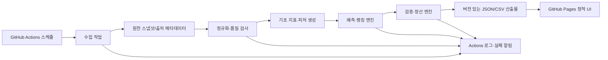

# KOSPI 장전 예측·랭킹 시스템 설계

문서 버전: 0.1-draft  
프로젝트 식별자: `kospi-premarket-ranking`  
기준 시간대: Asia/Seoul (KST)  
상태: 구현 전 설계 초안

> 이 시스템은 공개 데이터에 기반한 정보 제공·사후 검증 서비스다. 자동매매를 수행하지 않으며, 수익·정확도·손실 회피를 보장하지 않는다. 예측값은 불확실성을 포함한 분석 결과이고 투자 조언이나 매매 권유가 아니다.

## 1. 목적과 범위

### 1.1 목표

거래일마다 다음 네 시점의 산출물을 공개한다.

| 목표 시각(KST) | 산출물 | 의미 |
|---|---|---|
| 07:00 이전/전후 | 전일 정산 | 전 거래일의 예측과 실제 결과를 확정하고 오류를 계산 |
| 08:00 | 기초 분석 | 전일 데이터, 지수·종목 기초 지표, 공시·뉴스 입력을 정규화 |
| 08:30 | 장전 예측·랭킹 | 당일 예상 시작가·종가·수익률 및 순위 공개 |
| 장 마감 후 | 실제 결과 정산 | 실제 시작가·종가·수익률을 수집하고 예측 오차를 갱신 |

초기 공개 범위는 KOSPI 구성 종목 중 데이터 품질 기준을 통과한 대상이다. 대상 종목 목록, 제외 기준, 가격 기준, 모델 종류는 구현 전에 확정한다. 자동 주문, 브로커 연동, 계좌 접근, 레버리지·파생상품 거래, 사용자별 포트폴리오 추천은 범위에서 제외한다.

### 1.2 현재 저장소 기준선

실제 제품 기준선은 로컬 OmniForge 작업공간이 아니라 GitHub 원격 저장소 `chansday/chansday.github.io`의 `main` 브랜치다. 최신 확인 기준 커밋은 `d5410c4df59774b48d7832730b098bc91478d69a`이며, 해당 커밋에는 새 GitHub Pages/GitHub Actions 기반 구조가 원격으로 반영되어 있다. 이 문서의 설계와 구현 대조는 해당 원격 저장소·브랜치·커밋을 기준으로 수행해야 한다.

로컬 `C:/Users/MosesPark/OneDrive/Desktop/workidir`는 OmniForge 오케스트레이션 작업공간이며 제품 저장소와 별도다. 따라서 로컬 작업공간의 `output/kospi-premarket-ranking/`에 제품 파일이 보이지 않는다는 사실은 원격 제품 기준선이 없다는 뜻이 아니다. 로컬에는 이번 설계 문서와 오케스트레이션 산출물만 존재할 수 있으며, 실제 Pages 경로·Actions 권한·기존 파일 호환성은 위 원격 커밋에서 확인한다.

## 2. 설계 원칙

1. **재현성**: 모든 예측·정산에 데이터 기준 시각, 소스, 수집 시각, 코드/모델 버전을 남긴다.
2. **관측 시점 준수**: 장전 예측은 08:30 컷오프 이후 공개된 정보가 섞이지 않도록 입력을 동결한다. 사후 데이터 누수는 금지한다.
3. **원천 보존**: 파싱된 값과 함께 원문 응답의 해시·메타데이터를 보존한다. 원문 저장은 소스 약관과 저장 허용 범위에 따른다.
4. **실패 격리**: 한 소스·종목의 실패가 전체 결과를 조용히 오염시키지 않게 품질 상태와 제외 사유를 표시한다.
5. **보수적 표현**: 표본 밖 성능, 미래 수익, 정확도, 순위를 보장하는 문구를 사용하지 않는다.
6. **공개 최소화**: 정적 페이지에는 필요한 결과와 출처·시각·상태만 공개하고 비밀정보·운영 로그·개인정보를 배포하지 않는다.

## 3. 기술 아키텍처



### 3.1 구성요소

| 구성요소 | 책임 | 저장/실행 위치(목표) |
|---|---|---|
| 스케줄 오케스트레이터 | KST 기준 잡 실행, 중복 방지, 재시도 | GitHub Actions |
| 소스 어댑터 | 공개 데이터 소스별 요청·파싱·출처 기록 | Actions runner의 작업 코드 |
| 정규화/품질 게이트 | 가격·거래일·통화·결측·중복·지연 검사 | Actions runner |
| 피처/예측 엔진 | 컷오프 시점 입력으로 예상 가격·수익률 계산 | Actions runner |
| 정산 엔진 | 실제 값 연결, 오차·성과 지표 계산 | Actions runner |
| 아티팩트 저장소 | 날짜별 JSON/CSV, 스키마 버전, 매니페스트 | Pages가 제공하는 정적 파일 또는 저장소 아티팩트 |
| 프론트엔드 | 최신 결과·이력·상태·면책 표시 | GitHub Pages |
| 관측성 | 구조화 로그, 실행 요약, 실패 알림, freshness | GitHub Actions |

GitHub Actions는 정확한 시각 실행을 보장하지 않으므로 스케줄은 목표 시간보다 앞서 설정하고, 작업 내부에서 `scheduled_for`, `started_at`, `cutoff_at`, `published_at`을 기록한다. Actions 지연이 허용 한계를 넘으면 “지연 공개” 상태를 표시한다. 정확한 장중·장외 시세가 필요하면 Pages/Actions만으로 해결한다고 가정하지 말고, 승인된 별도 실행 환경을 검토한다.

### 3.2 권장 저장 구조

```text
output/kospi-premarket-ranking/
├── docs/SYSTEM_DESIGN.md
├── app/                         # 구현 단계에서 추가
├── data/
│   ├── public/latest.json       # Pages가 제공하는 최신 공개 결과
│   └── public/YYYY-MM-DD/*.json # 날짜별 불변 결과
├── schemas/                     # JSON Schema
├── static/                      # Pages 정적 UI
├── .github/workflows/           # 구현 저장소 정책에 맞춰 추가
└── README.md                    # 구현 단계에서 추가
```

위 경로는 목표 구조이며 현재 작업 트리에 실제로 존재하는 코드 구조를 의미하지 않는다.

## 4. 데이터 수집 운영안

### 4.1 원천 선택과 사용 조건

데이터는 공개 접근이 허용된 소스와 공식·신뢰 가능한 공개 자료를 우선한다. 소스별 이용약관, robots 정책, 호출 제한, 재배포 권한, 지연 여부, 수정·정정 정책을 구현 전에 기록하고 승인한다. 로그인 우회, CAPTCHA 우회, 비공개 API 추출, 과도한 병렬 호출, IP 차단 회피, 약관상 금지된 재배포는 하지 않는다.

소스 레지스트리는 최소 다음을 가진다.

```json
{
  "source_id": "source_a",
  "display_name": "승인된 공개 데이터 소스",
  "data_types": ["daily_ohlcv", "calendar"],
  "access_mode": "public_http",
  "license_or_terms_url": "REPLACE_WITH_APPROVED_TERMS_URL",
  "redistribution_allowed": false,
  "rate_limit_per_minute": 30,
  "observed_delay": "end_of_day",
  "enabled": false,
  "last_reviewed_at": "2026-10-26T00:00:00+09:00"
}
```

예시 URL은 자리표시자다. 실제 배포 전 승인된 URL과 이용 조건으로 교체해야 한다.

### 4.2 수집 방식

- 요청에 식별 가능한 `User-Agent`와 연락처 정책을 사용하고, 소스가 요구하는 규칙을 따른다.
- 요청 타임아웃, 지수 백오프, 최대 재시도 횟수, 호출 간격을 설정한다.
- 응답 상태 코드·콘텐츠 유형·응답 크기·수집 시각·소스 버전·해시를 기록한다.
- HTML 구조 변경에 대비해 파서 버전과 필드별 검증을 둔다.
- 거래일 캘린더를 먼저 확인한다. 휴장일에는 예측·정산 잡을 “not_applicable”로 남기고 빈 결과를 정상으로 취급한다.
- 조정주가·액면분할·배당 반영 여부를 필드에 명시한다. 예상값과 실제값에 서로 다른 조정 기준을 섞지 않는다.
- 원천 값이 여러 개이면 소스 우선순위와 충돌 규칙을 적용하고, 선택·제외된 값의 이유를 기록한다.

### 4.3 품질 게이트

각 종목·필드에 대해 다음 상태를 평가한다.

`valid` · `stale` · `missing` · `conflict` · `outlier` · `not_applicable` · `source_error`

예시 규칙:

- 가격·수익률이 숫자이고 통화·단위가 알려져 있어야 한다.
- 시작가·종가가 0 이하이면 거부한다.
- 동일 종목·거래일의 중복 레코드는 하나의 정해진 규칙으로 병합하거나 제외한다.
- 소스의 관측 시각이 컷오프 이후이면 장전 피처에서 제외한다.
- 결측률, 종목별 최소 이력, 가격 급변 임계치, 거래량 이상치는 설정 파일로 관리하고 결과에 임계치를 기록한다.
- 품질 게이트 실패 시 순위에 억지로 넣지 않고 `eligibility.status`와 `eligibility.reasons`를 공개한다.

## 5. 데이터 모델

### 5.1 핵심 엔터티

| 엔터티 | 주요 키 | 설명 |
|---|---|---|
| `trading_calendar` | `market`, `trade_date` | 거래일·휴장일·세션 시간 |
| `instrument` | `instrument_id`, `as_of` | 종목 식별자, 이름, 시장, 상장 상태 |
| `market_observation` | `instrument_id`, `trade_date`, `field`, `source_id` | 원천 관측값과 출처 |
| `feature_snapshot` | `instrument_id`, `as_of`, `feature_set_version` | 컷오프 시점의 입력 피처 |
| `forecast` | `forecast_id`, `instrument_id`, `target_trade_date`, `cutoff_at` | 예측 가격·수익률·순위 |
| `settlement` | `forecast_id` | 실제값, 오류, 정산 상태 |
| `run_manifest` | `run_id` | 실행·코드·모델·아티팩트·품질 요약 |

### 5.2 가격·수익률 정의

설계 기본값은 다음과 같다. 최종 가격 정의는 구현 전 사용자/제품 결정이 필요하다.

```text
expected_return_pct = (expected_close_price / expected_start_price - 1) * 100
actual_return_pct   = (actual_close_price   / actual_start_price   - 1) * 100
return_error_pp     = expected_return_pct - actual_return_pct
start_price_error_pct = (expected_start_price - actual_start_price)
                         / actual_start_price * 100
close_price_error_pct = (expected_close_price - actual_close_price)
                         / actual_close_price * 100
```

`actual_start_price`는 기본적으로 해당 거래일의 공식·검증된 장 시작 가격을 사용한다. “첫 체결가”, “공식 시가”, “09:00 직후 관측값” 중 무엇을 채택할지는 소스의 정의와 정산 가능성을 확인한 뒤 고정한다. 예측에는 그 시점 이전에 관측 가능한 정보만 사용한다.

### 5.3 공개 JSON 예시

```json
{
  "schema_version": "1.0.0",
  "dataset": "premarket_ranking",
  "market": "KOSPI",
  "trade_date": "2026-10-27",
  "timezone": "Asia/Seoul",
  "as_of": "2026-10-27T08:30:00+09:00",
  "publication": {
    "status": "published",
    "run_id": "run_20261027_premarket_0830",
    "published_at": "2026-10-27T08:34:12+09:00",
    "delayed": true,
    "delay_reason": "github_actions_queue_delay"
  },
  "method": {
    "model_id": "baseline_v1",
    "feature_set_version": "features_v1",
    "ranking_key": "expected_return_pct_desc",
    "cutoff_at": "2026-10-27T08:30:00+09:00"
  },
  "items": [
    {
      "instrument_id": "EXAMPLE_001",
      "symbol": "000000",
      "name": "예시 종목",
      "rank": 1,
      "expected_start_price": 10000.0,
      "expected_close_price": 10200.0,
      "expected_return_pct": 2.0,
      "confidence": null,
      "eligibility": {
        "status": "valid",
        "reasons": []
      },
      "input_provenance": [
        {
          "source_id": "source_a",
          "observed_at": "2026-10-27T08:12:00+09:00",
          "content_hash": "sha256:REDACTED_EXAMPLE"
        }
      ],
      "settlement": {
        "status": "pending",
        "actual_start_price": null,
        "actual_close_price": null,
        "actual_return_pct": null,
        "return_error_pp": null,
        "start_price_error_pct": null,
        "close_price_error_pct": null,
        "settled_at": null
      }
    }
  ],
  "disclaimer": "정보 제공 목적이며 수익·정확도·손실 회피를 보장하지 않습니다. 자동매매를 수행하지 않습니다."
}
```

실제 가격·종목 데이터는 예시 문서에 포함하지 않는다. 샘플 식별자와 해시는 테스트용 자리표시자다.

### 5.4 실행 매니페스트 예시

```json
{
  "run_id": "run_20261027_settlement_1705",
  "job_type": "settlement",
  "scheduled_for": "2026-10-27T17:05:00+09:00",
  "started_at": "2026-10-27T17:06:01+09:00",
  "finished_at": "2026-10-27T17:08:40+09:00",
  "code_version": "git:COMMIT_SHA",
  "model_version": "baseline_v1",
  "source_ids": ["source_a"],
  "record_counts": {
    "eligible": 700,
    "settled": 688,
    "missing_actual": 12
  },
  "quality": {
    "status": "partial",
    "warnings": ["12 instruments missing actual close"]
  },
  "artifacts": [
    {
      "path": "data/public/2026-10-27/settlement.json",
      "sha256": "sha256:REDACTED_EXAMPLE"
    }
  ]
}
```

## 6. 일일 파이프라인

### 6.1 거래일 기준 흐름

1. **전 거래일 장 마감 후**: 실제 시작가·종가와 거래일 식별자를 수집한다.
2. **장 마감 후 정산**: `forecast`와 실제값을 키로 결합하고 가격 오차·수익률 오차·방향 적중 여부를 계산한다.
3. **07:00 정산 잡**: 전 거래일 정산이 끝났는지 재확인하고, 미완료 필드는 `pending` 또는 `partial`로 공개한다. 수정된 원천 데이터가 있으면 새 버전 정산을 만들고 이전 결과를 덮어쓰지 않는다.
4. **08:00 기초 분석 잡**: 전일 확정 데이터와 08:00 이전 허용 입력만으로 피처를 생성한다.
5. **08:30 예측 잡**: 피처 스냅샷을 동결하고 예측·랭킹을 산출한다. 실제 시작가나 장중 데이터는 사용하지 않는다.
6. **게시 단계**: JSON/CSV 매니페스트를 생성하고 스키마·면책·출처·품질 상태를 검사한 후 Pages 공개 파일을 갱신한다.
7. **장 마감 후 재정산**: 실제 데이터가 준비되는 즉시 정산하며, 정산 지연 시 다음 재시도 창을 사용한다.

### 6.2 멱등성과 재실행

실행 키는 `job_type + market + trade_date + cutoff_or_settlement_version`으로 만든다. 동일 키의 재실행은 새 `run_id`와 새 아티팩트를 만들되, 공개 포인터(`latest.json`)는 품질 게이트를 통과한 최신 버전만 가리킨다. 중복 게시, 부분 파일 게시, 이전 버전 삭제를 방지하기 위해 임시 디렉터리 생성 후 매니페스트 검증이 완료되면 원자적으로 반영한다.

## 7. 예측·랭킹·검증 방법

### 7.1 초기 모델 정책

초기에는 해석 가능한 기준선 모델을 우선한다. 예를 들어 전일 수익률, 최근 변동성, 거래량 변화, 시장·업종 지표와 같은 피처를 사용할 수 있으나, 실제 사용 가능 여부와 데이터 누수 여부를 검증해야 한다. 특정 모델·피처·하이퍼파라미터를 이 문서만으로 확정하지 않는다.

모델은 다음을 요구한다.

- 피처 생성 시점과 예측 컷오프가 명시되어야 한다.
- 학습·검증·테스트 기간을 시간 순서대로 분리한다.
- 생존자 편향, 상장폐지 종목 누락, 거래정지, 액면분할·배당 조정, 결측 대체의 영향을 기록한다.
- 모델 버전과 입력 스키마가 바뀌면 새 버전으로 평가하고 기존 결과를 재작성하지 않는다.
- 표본 밖 성능을 실시간 성능으로 표현하지 않는다.

### 7.2 랭킹

기본 랭킹 키는 `expected_return_pct` 내림차순이다. 동률은 예측값 정밀도, 품질 점수, 안정적인 보조 키 순으로 결정하되 규칙을 공개한다. 입력 품질이 `valid`가 아니면 기본적으로 순위에서 제외한다. 제외 종목도 이유를 볼 수 있어야 한다.

### 7.3 정산 지표

최소 공개 지표는 종목별 다음 항목이다.

- 예상 시작가, 예상 종가, 예상 수익률
- 실제 시작가, 실제 종가, 실제 수익률
- 시작가 오차, 종가 오차, 수익률 오차(percentage points)
- 방향 적중 여부(예상 수익률과 실제 수익률의 부호가 같은지)
- 정산 상태와 데이터 기준 시각

집계 지표는 MAE, RMSE, 평균 오차, 중앙값 절대 오차, 방향 적중률, 예측 가능 종목 수, 누락·제외 수를 사용한다. 집계 기간, 종목 가중 방식, 거래비용·슬리피지 미반영 여부를 함께 표시한다. 누적 수익률 곡선을 투자 성과처럼 제시하려면 별도의 제품 승인과 명확한 가정·비용·벤치마크가 필요하다.

### 7.4 검증 계획

1. 단위 테스트: 수익률·오차 공식, 거래일 판정, 순위 동률, 결측 상태.
2. 계약 테스트: 소스 어댑터 출력, JSON Schema, 매니페스트, Pages 공개 경로.
3. 재현성 테스트: 같은 스냅샷·코드·모델 버전에서 같은 결과가 나오는지.
4. 누수 테스트: 컷오프 이후 필드가 피처 입력에 들어가지 않는지.
5. 백테스트: 시간 순서 분리와 생존자 편향 점검. 백테스트 결과는 미래 보장이 아니다.
6. 운영 리허설: 소스 장애, 파서 변경, Actions 지연, 부분 정산, 재실행.
7. 공개 검토: 면책, 소스 표시, `pending/partial/stale` 상태, 마지막 갱신 시각이 UI에 표시되는지.

## 8. 보안·약관·라이선스

- GitHub Actions secrets에는 저장소 토큰 등 최소 권한만 둔다. API 키가 필요해지는 경우에도 문서·로그·정적 산출물에 값이 나오지 않도록 마스킹한다.
- 공개 Pages 파일에는 비밀, 개인 식별정보, 내부 실행 로그, 인증 헤더, 원천 응답의 금지된 전문을 넣지 않는다.
- 데이터 소스별 라이선스·재배포·캐시·상업적 이용·표시 의무를 레지스트리와 README에 기록한다.
- 소스가 재배포를 허용하지 않으면 원천 데이터 전문을 공개 저장소에 커밋하지 않고, 허용된 파생 지표·출처 링크·수집 시각만 공개한다.
- 저작권·상표·데이터베이스권 및 거래소·벤더 약관을 확인한다. 약관 회피나 서비스 부하를 유발하는 수집은 금지한다.
- GitHub Pages와 Actions의 저장소 공개 범위, fork/PR에서의 secret 노출, workflow 권한, dependency pinning을 검토한다.
- 모든 외부 의존성은 버전을 고정하고, Actions는 가능하면 커밋 SHA로 고정한다. 공급망 점검과 업데이트 절차를 둔다.
- 문구에는 “투자 조언 아님”, “수익·정확도 보장 없음”, “자동매매 없음”, “지연·결측 가능”을 일관되게 포함한다.

## 9. 실패 처리와 관측성

### 9.1 실패 분류

| 실패 | 처리 | 공개 상태 |
|---|---|---|
| 네트워크·일시적 5xx | 제한된 지수 백오프 재시도 | `delayed` |
| 요청 제한·약관 위반 우려 | 즉시 중단, 호출량 축소·수동 검토 | `blocked_source` |
| 파서 구조 변경 | 해당 소스 격리, 이전 유효 스냅샷과 혼동 금지 | `source_error` |
| 일부 종목 결측 | 종목 제외 또는 `partial`, 이유 공개 | `partial` |
| 예측 엔진 오류 | 새 공개 파일 게시 금지, 마지막 정상 결과와 시각 표시 | `failed` |
| 정산 데이터 지연 | 재시도 창 유지, 실제값은 `pending` | `pending` |
| Actions 지연 | 지연 시간을 매니페스트에 기록, 허용 한도 초과 시 경보 | `delayed` |

### 9.2 로그·메트릭·알림

구조화 로그에 `run_id`, `job_type`, `trade_date`, `source_id`, `instrument_count`, `duration_ms`, `retry_count`, `quality_status`, `artifact_path`를 기록한다. 비밀·원천 인증정보·개인정보는 로그에 쓰지 않는다.

운영 대시보드 또는 Actions 요약에서 다음을 추적한다.

- 마지막 성공 실행 시각과 데이터 freshness
- 단계별 성공·실패·재시도 횟수
- 소스별 HTTP 오류·파싱 오류·지연
- 입력 결측률·충돌률·제외 종목 수
- 예측 산출 수·정산 완료 수·pending 수
- Pages 게시 성공 여부와 아티팩트 해시

초기 알림은 작업 실패, 허용 지연 초과, 결측률 임계치 초과, 스키마 검증 실패, 비정상적으로 낮은 산출 건수에 한정한다. 같은 장애에 대해 중복 알림을 줄이고, 정상 상태에서는 알림을 보내지 않는다.

## 10. 단계별 로드맵

### 단계 0 — 결정·준수 확인

- 실제 GitHub 저장소·브랜치·Pages 설정 확인
- 데이터 소스 후보와 약관·라이선스·재배포 가능 여부 승인
- 거래일·시가·종가·조정가격 정의 확정
- 공개 범위와 면책 문구 확정

완료 조건: 미확정 항목이 구현을 막지 않는 수준으로 결정되고, 키·개인정보 없이 샌드박스 입력을 준비한다.

### 단계 1 — 수집·정규화 수직 슬라이스

- 한 개 승인 소스와 소수의 테스트 종목으로 수집
- 캘린더·원천 메타데이터·품질 상태·JSON Schema 구현
- 재현 가능한 로컬/Actions 실행과 실패 재시도 구현

완료 조건: 샘플 스냅샷에서 멱등성·스키마·민감정보 검사가 통과한다.

### 단계 2 — 장전 기준선 예측·정적 게시

- 08:00 피처와 08:30 예측 컷오프 구현
- 예상 시작가·종가·수익률·랭킹 공개
- GitHub Pages UI와 출처·상태·면책 표시

완료 조건: 과거 스냅샷 재생으로 누수 없는 결과를 만들고 Pages 공개 파일을 검증한다.

### 단계 3 — 실제 정산·이력·관측성

- 장 마감 실제값 수집 및 07:00 정산
- 오류·방향 적중률·집계 지표 및 이력 화면
- Actions 실패·지연·결측 알림

완료 조건: 정상·부분·실패·재실행 시나리오가 모두 공개 상태를 일관되게 표현한다.

### 단계 4 — 품질 개선

- 추가 소스와 충돌 규칙 검토
- 모델 후보의 시간 순서 검증·모델 카드·성능 변화 추적
- 접근성·성능·비용·약관 재검토

모델 개선은 기준선 대비 검증 증거가 있을 때만 채택하며, 성과 보장 문구로 이어지지 않는다.

## 11. 사용자에게 필요한 제공사항

구현·운영 전 사용자 또는 제품 책임자가 다음을 제공하거나 결정해야 한다.

1. 실제 GitHub 저장소 URL, 기본 브랜치, Pages 배포 방식과 저장소 공개 범위.
2. 사용 허가가 확인된 공개 데이터 소스 목록, 약관·라이선스·재배포 조건.
3. KOSPI 대상 종목 범위와 종목 식별자 규칙.
4. 거래일 캘린더의 기준, 장 시작·마감 시각, 시가·종가 정의.
5. 가격 조정(분할·배당)과 통화·소수점 정책.
6. 07:00/08:00/08:30/장 마감 후의 허용 지연과 재시도 시간.
7. 공개 이력 보존 기간, 정정 데이터 처리, 삭제 요청 대응 정책.
8. 수익률·정확도 집계에서 제외할 종목과 최소 데이터 이력.
9. 알림 수신 채널과 장애 대응 담당자.
10. 제품명·면책·출처 표시 문구에 대한 검토 주체.

비밀정보는 문서나 커밋으로 제공하지 말고, 승인된 비밀 저장소에 최소 권한으로 등록한다.

## 12. 미확정 사항

다음은 이 문서에서 임의로 확정하지 않았다.

- 실제 데이터 소스와 재배포 가능 범위
- GitHub Pages가 저장소 내 어느 디렉터리에서 배포되는지
- GitHub Actions 스케줄의 정확한 cron 값과 실행 지연 허용치
- KOSPI 전 종목과 선별 종목 중 어느 범위를 사용할지
- `actual_start_price`의 공식 정의와 정산 소스
- 수정·정정된 가격을 어느 시점에 재정산할지
- 예측 모델·피처·학습 주기·최소 표본
- confidence를 공개할지, 공개한다면 그 의미와 보정 방법
- 순위에서 제외된 종목을 UI에 어떤 수준으로 표시할지
- 데이터 및 실행 로그 보존 기간·비용
- 사용자 인증, 댓글, 개인화가 필요한지 여부

이 항목이 제품 방향·약관·비용에 영향을 주므로 구현자가 임의로 결정해서는 안 된다.

## 13. 주요 위험과 완화책

| 위험 | 영향 | 완화책 | 잔여 위험 |
|---|---|---|---|
| 소스 약관·재배포 제한 | 게시 중단·법적 분쟁 | 사전 승인 레지스트리, 원문 비공개, 정기 약관 검토 | 약관 변경 감지 지연 |
| 소스 지연·오류 | 잘못된 예측·정산 | 컷오프·freshness·품질 상태·다중 소스 검토 | 대체 소스도 동시에 실패 가능 |
| 데이터 누수 | 과대평가·잘못된 신뢰 | 시점 동결, 시간순 분할, 누수 테스트 | 숨은 타임스탬프 오류 |
| GitHub Actions 지연 | 08:30 이후 게시 | 지연 공개 표시, 허용 지연 경보, 별도 실행 환경 검토 | 정확한 시각 보장 불가 |
| 가격 정의 불일치 | 오차 왜곡 | 시가·종가 정의 고정, 출처·조정 상태 공개 | 소스 간 정의 차이 |
| 생존자 편향·구성종목 변경 | 백테스트 왜곡 | 당시 구성·상장폐지 이력 보존 | 과거 데이터 부족 |
| 모델 과적합 | 실시간 성능 저하 | 단순 기준선, 시간순 검증, 모델 카드 | 시장 체제 변화 |
| 투자 오인 | 사용자 피해 | 명시적 면책, 불확실성·누락 표시, 자동매매 없음 | 사용자의 부적절한 해석 |
| Actions/의존성 공급망 | 코드·데이터 변조 | SHA 고정, 최소 권한, 의존성 점검 | 외부 장애·취약점 |
| 공개 저장소 정보 노출 | 키·운영정보 유출 | secrets, 로그 마스킹, 공개 전 스캔 | 잘못된 설정 커밋 |

## 14. 구현·검증 체크리스트

- [ ] 실제 제품 README와 기존 워크플로를 대조했다.
- [ ] 소스별 약관·라이선스·재배포 검토 기록이 있다.
- [ ] 거래일·시가·종가·가격 조정 정의가 확정됐다.
- [ ] JSON Schema와 예시가 일치한다.
- [ ] 08:30 컷오프 이후 입력이 차단된다.
- [ ] 예측·정산·재실행이 멱등적이다.
- [ ] 품질 실패와 부분 결과가 사용자에게 표시된다.
- [ ] 예상/실제 가격·수익률·오차 필드가 모두 표시된다.
- [ ] 수익·정확도 보장 및 자동매매 오해를 막는 문구가 있다.
- [ ] 민감정보·API 키·개인정보가 산출물과 로그에 없다.
- [ ] Actions와 Pages의 실제 기동·게시 smoke test를 완료했다.
- [ ] 독립 QA/보안 검토와 운영 리허설을 완료했다.

## 15. 문서 상태와 다음 단계

이 문서는 현재 저장소에 기존 KOSPI 구현 파일이 없는 상태에서 작성한 목표 설계 초안이다. 다음 단계는 실제 저장소·Pages·Actions 구조를 확인하고, 단계 0의 미확정 사항을 결정한 뒤 스키마·수집 어댑터·첫 번째 수직 슬라이스를 별도 승인 계약으로 구현하는 것이다.


